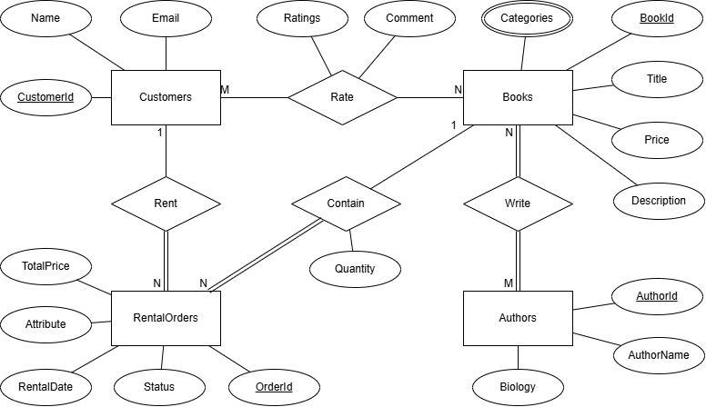
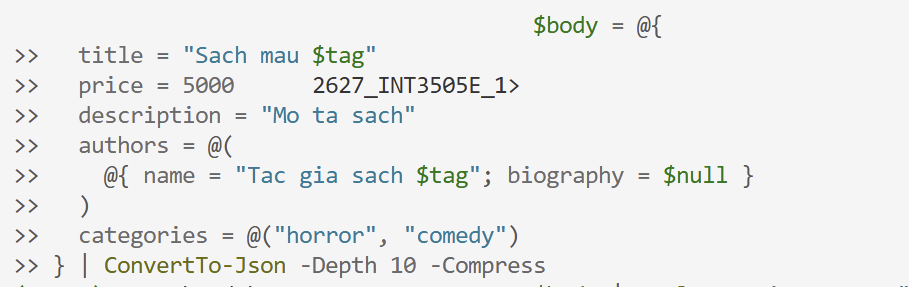
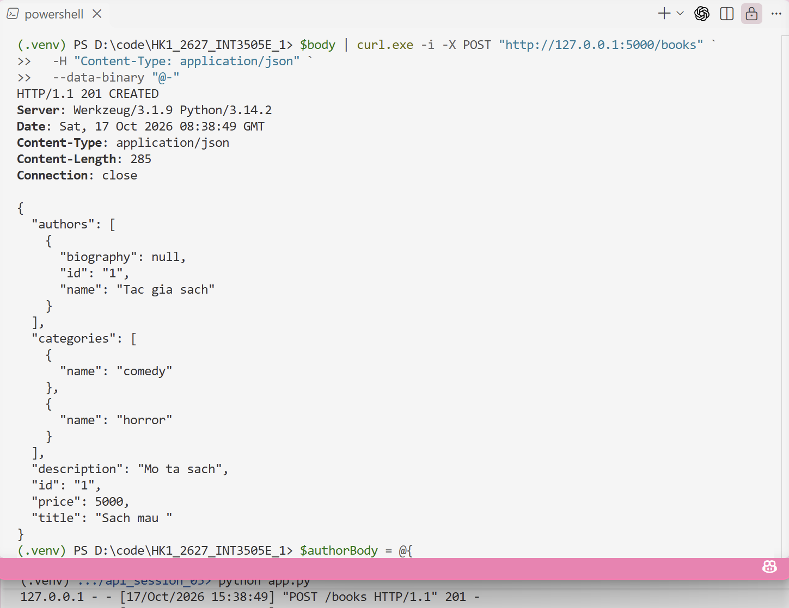
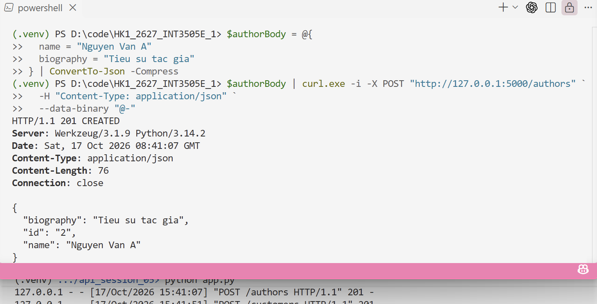
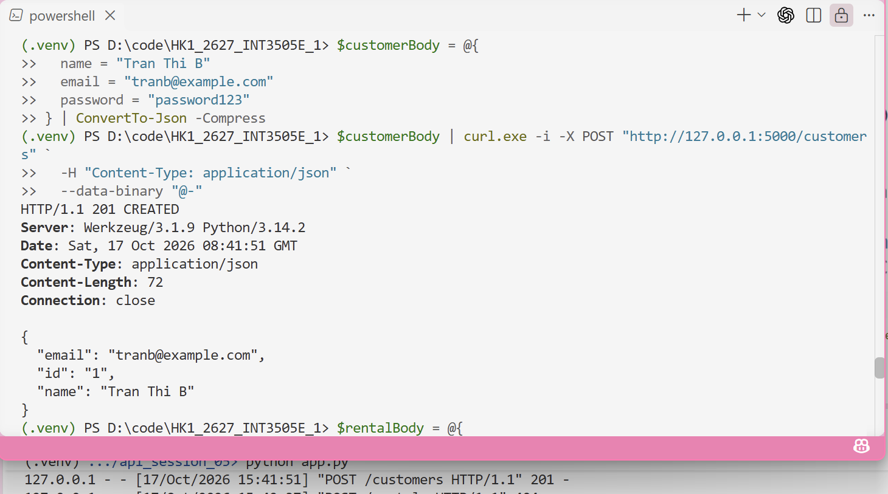
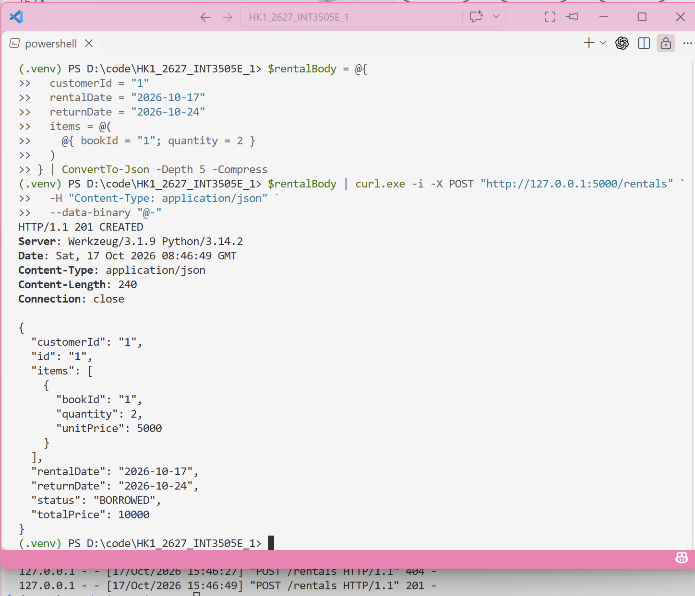
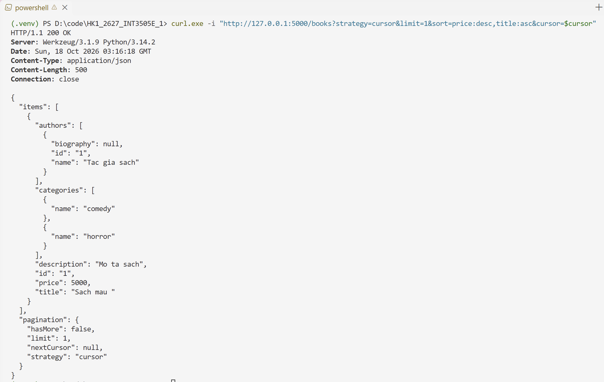
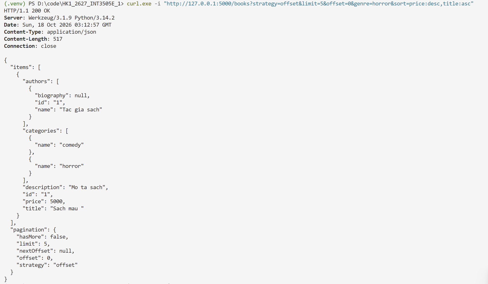

# Library API — BTVN Week 5 - Lab 1

JSON Schemas
## Book

`authors` phải có ít nhất một tác giả. Nếu tên tác giả chưa tồn tại, API tạo tác giả mới và sinh ID tự động. `categories` là danh sách tên thể loại; tên cũng là khóa của category.

```json
{
  "$schema": "https://json-schema.org/draft/2020-12/schema",
  "$id": "https://example.com/schemas/book-create.json",
  "title": "BookCreate",
  "type": "object",
  "additionalProperties": false,
  "properties": {
    "title": {
      "type": "string",
      "minLength": 1,
      "maxLength": 255
    },
    "price": {
      "type": "integer",
      "minimum": 0,
      "description": "Giá sách tính bằng VND."
    },
    "description": {
      "type": ["string", "null"]
    },
    "authors": {
      "type": "array",
      "minItems": 1,
      "items": {
        "type": "object",
        "additionalProperties": false,
        "properties": {
          "name": {
            "type": "string",
            "minLength": 1,
            "maxLength": 100
          },
          "biography": {
            "type": ["string", "null"]
          }
        },
        "required": ["name"]
      }
    },
    "categories": {
      "type": "array",
      "items": {
        "type": "string",
        "minLength": 1,
        "maxLength": 50
      },
      "uniqueItems": true,
      "default": []
    }
  },
  "required": ["title", "price", "authors"]
}
```

## Customer

```json
{
  "$schema": "https://json-schema.org/draft/2020-12/schema",
  "$id": "https://example.com/schemas/customer-create.json",
  "title": "CustomerCreate",
  "type": "object",
  "additionalProperties": false,
  "properties": {
    "name": {
      "type": "string",
      "minLength": 1,
      "maxLength": 100
    },
    "email": {
      "type": "string",
      "format": "email",
      "maxLength": 255
    },
    "password": {
      "type": "string",
      "minLength": 6,
      "maxLength": 100
    }
  },
  "required": ["name", "email", "password"]
}
```

## Rental Order

Mỗi phần tử trong `items` chỉ định một sách và số lượng thuê. API kiểm tra `returnDate` không sớm hơn `rentalDate`.

```json
{
  "$schema": "https://json-schema.org/draft/2020-12/schema",
  "$id": "https://example.com/schemas/rental-order-create.json",
  "title": "RentalOrderCreate",
  "type": "object",
  "additionalProperties": false,
  "properties": {
    "customerId": {
      "type": "string",
      "minLength": 1
    },
    "rentalDate": {
      "type": "string",
      "format": "date"
    },
    "returnDate": {
      "type": "string",
      "format": "date"
    },
    "items": {
      "type": "array",
      "minItems": 1,
      "items": {
        "type": "object",
        "additionalProperties": false,
        "properties": {
          "bookId": {
            "type": "string",
            "minLength": 1
          },
          "quantity": {
            "type": "integer",
            "minimum": 1
          }
        },
        "required": ["bookId", "quantity"]
      }
    }
  },
  "required": ["customerId", "rentalDate", "returnDate", "items"]
}
```

### Ví dụ request

```json
{
  "customerId": "CUSTOMER_ID",
  "rentalDate": "2026-10-17",
  "returnDate": "2026-10-24",
  "items": [
    { "bookId": "BOOK_ID", "quantity": 2 }
  ]
}
```

## ER Diagram



## Test endpoints
### Tạo 1 sách mới



### Tạo tác giả mới


### Tạo customer


### Tạo 1 đơn thuê sách


# Library API — BTVN Week 5 - Lab 2

## Pagination Cursor


## Pagination Offset
