# BTVN Week 7
## Code-first và Des-first
### Code-first
Giao diện chạy trên swagger
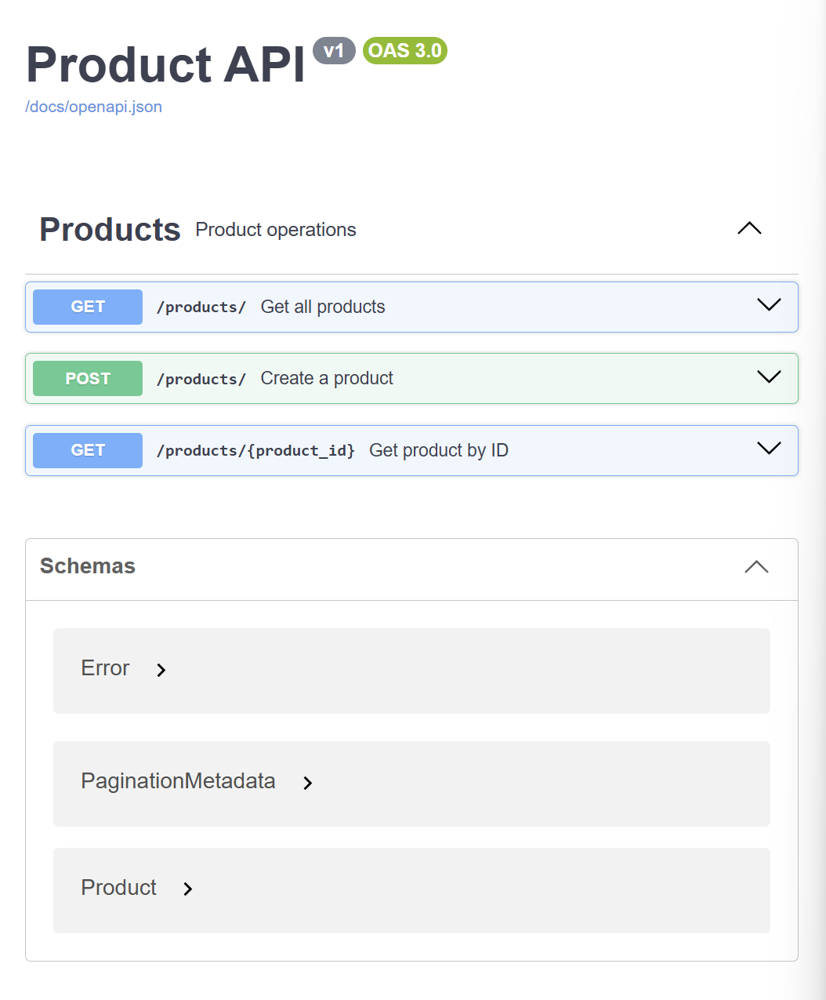
Thử nghiệm với postman
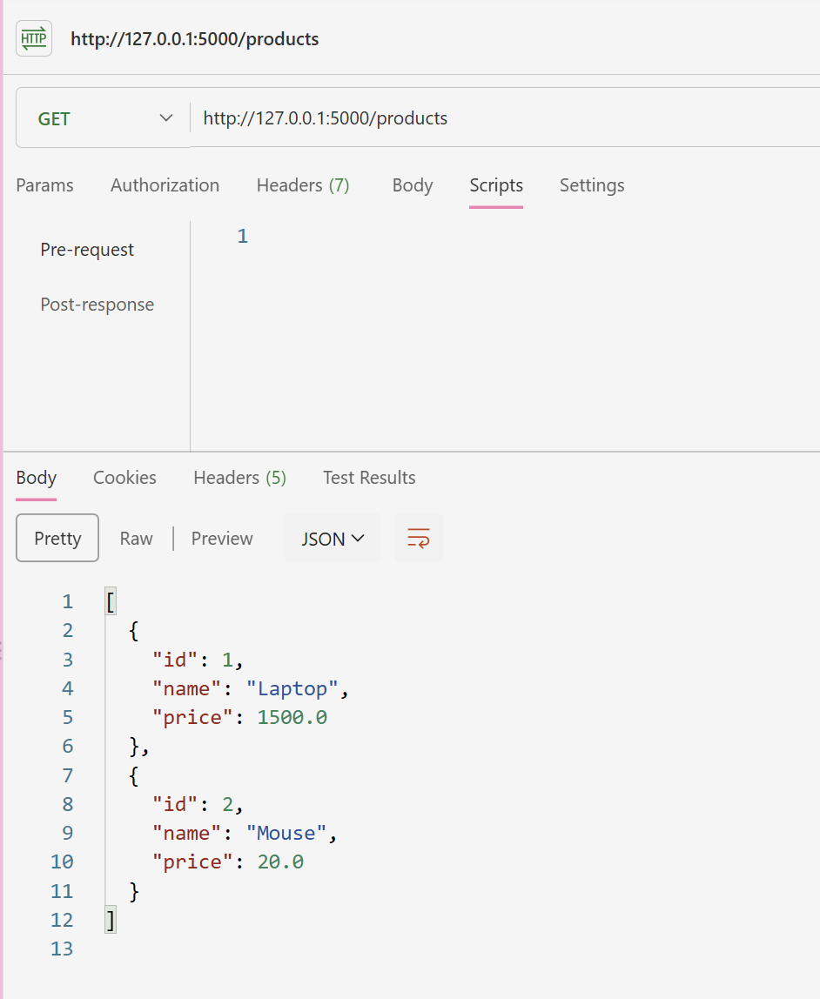
### Des-first
Giao diện chạy trên swagger
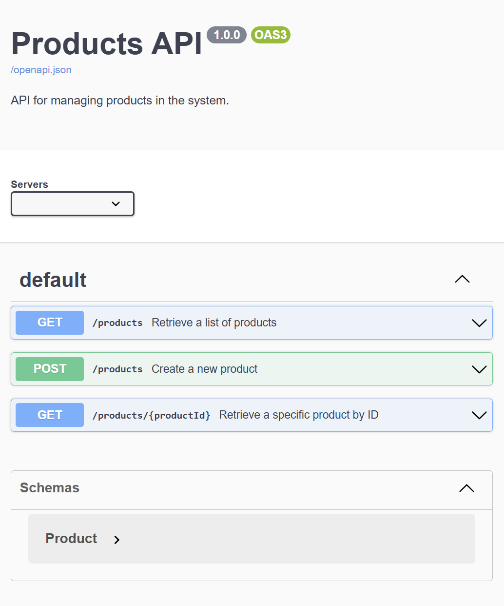
Thử nghiệm với postman
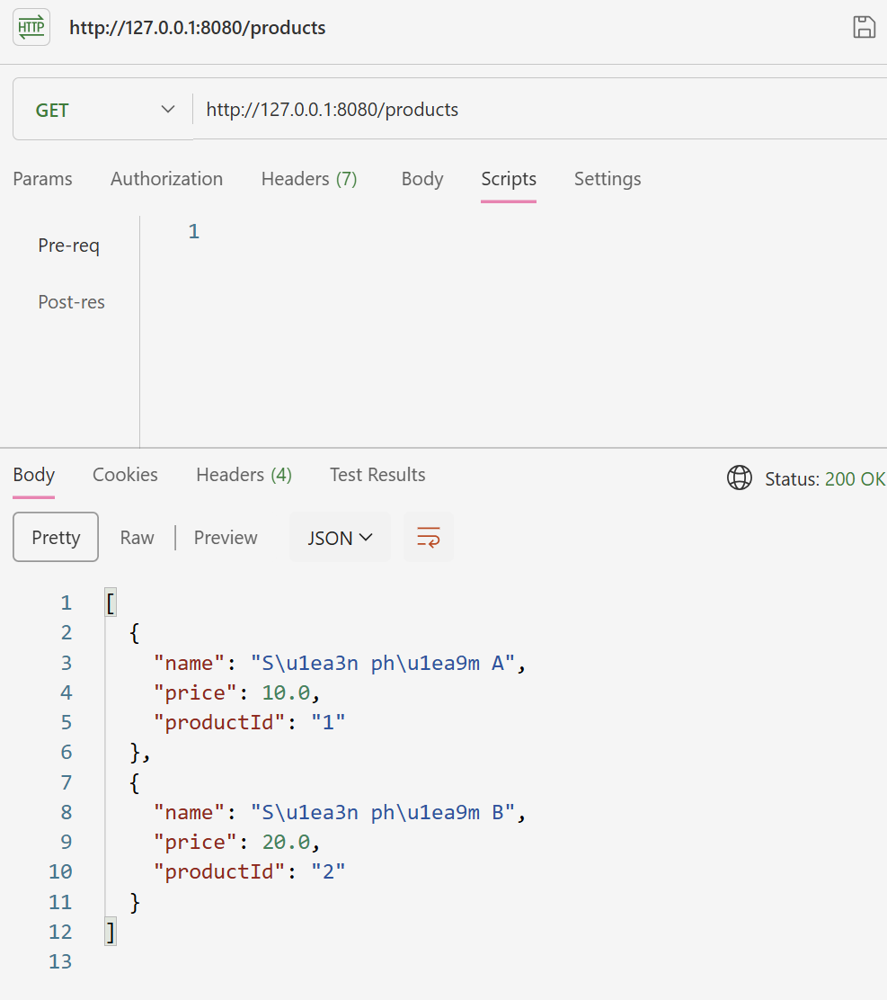

## Lab 1
### Tạo endpoints chạy thử trên Postman
Tạo mới dữ liệu
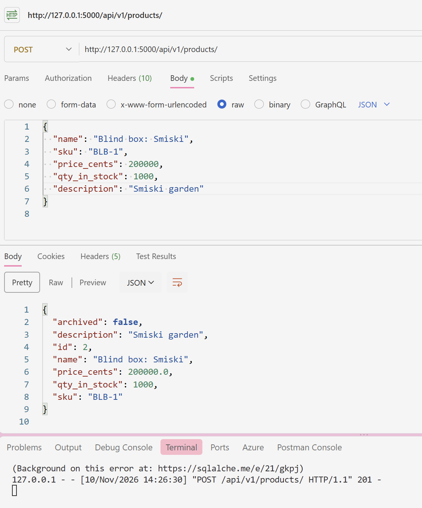
Đặt trước sản phẩm
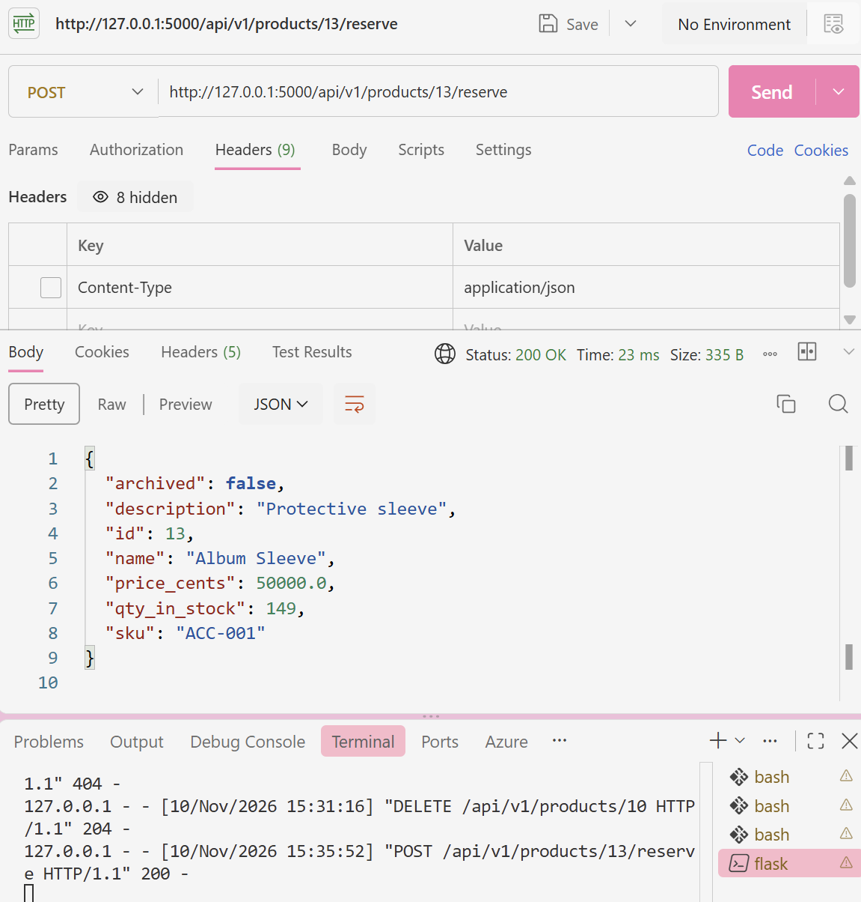
List dữ liệu có phân trang
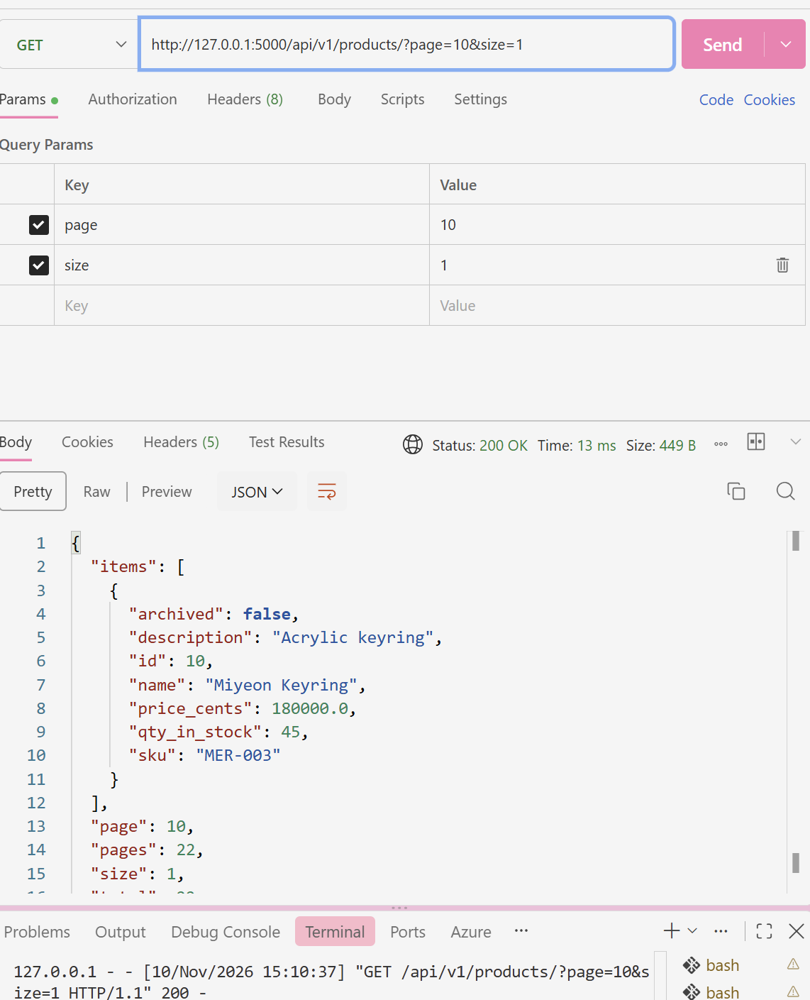
Tìm dữ liệu theo ID
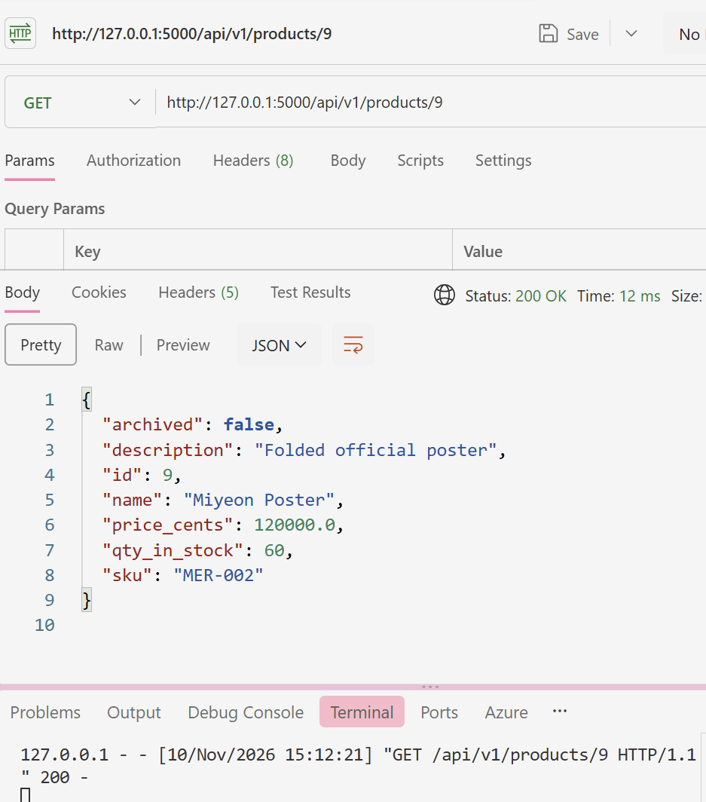
Patch
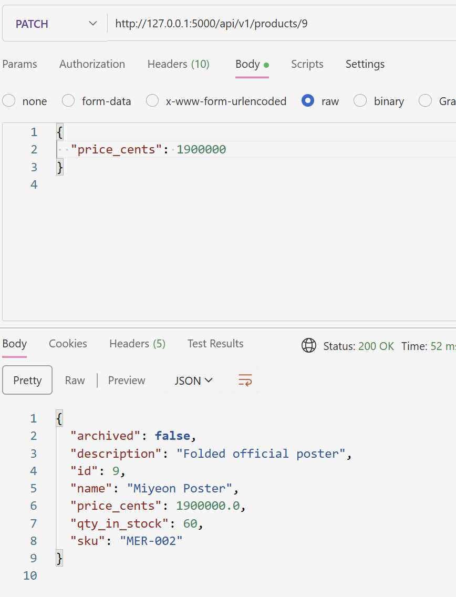
Soft Delete
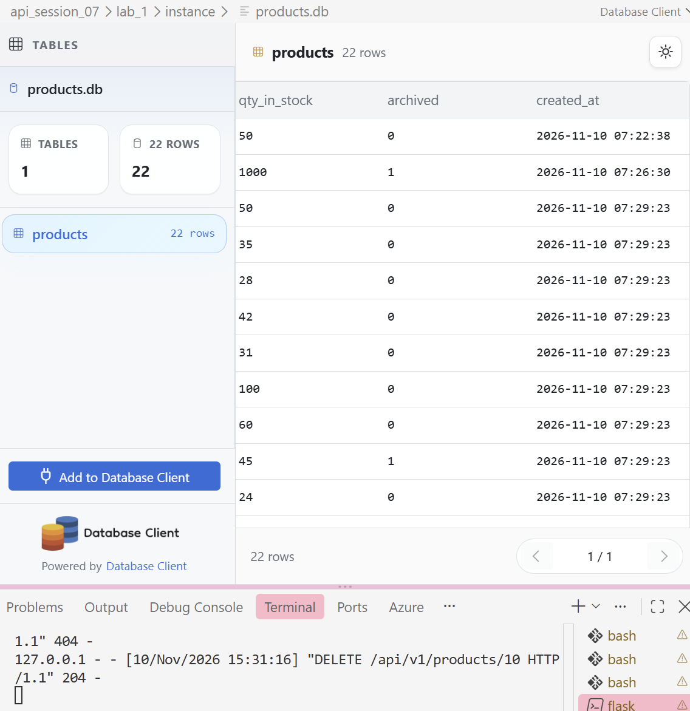
### Hoàn thành tiếp đến phần gunicorn.conf.py
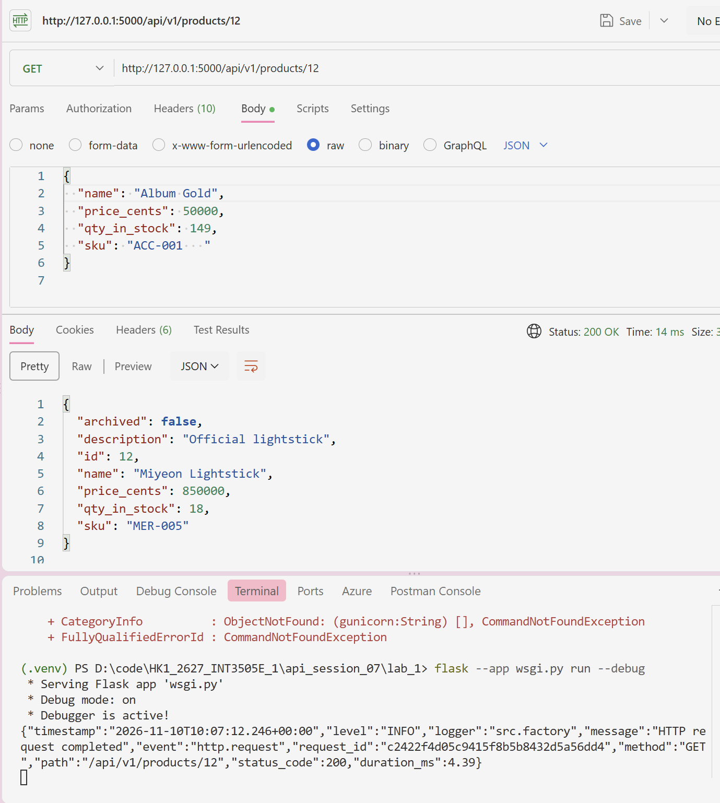