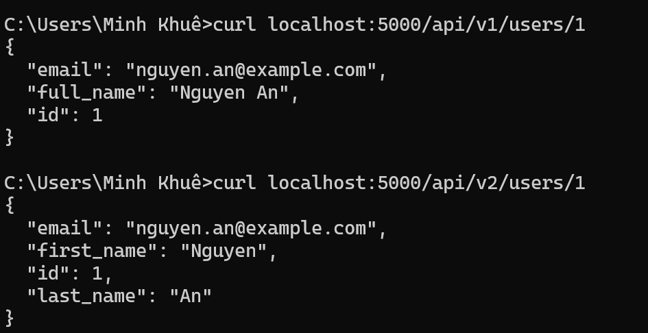
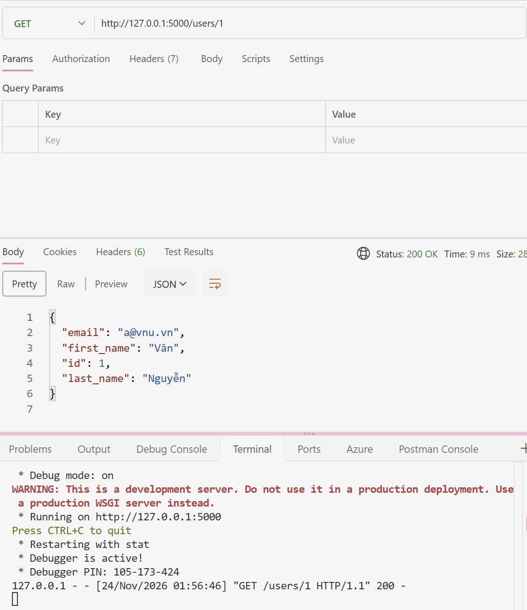
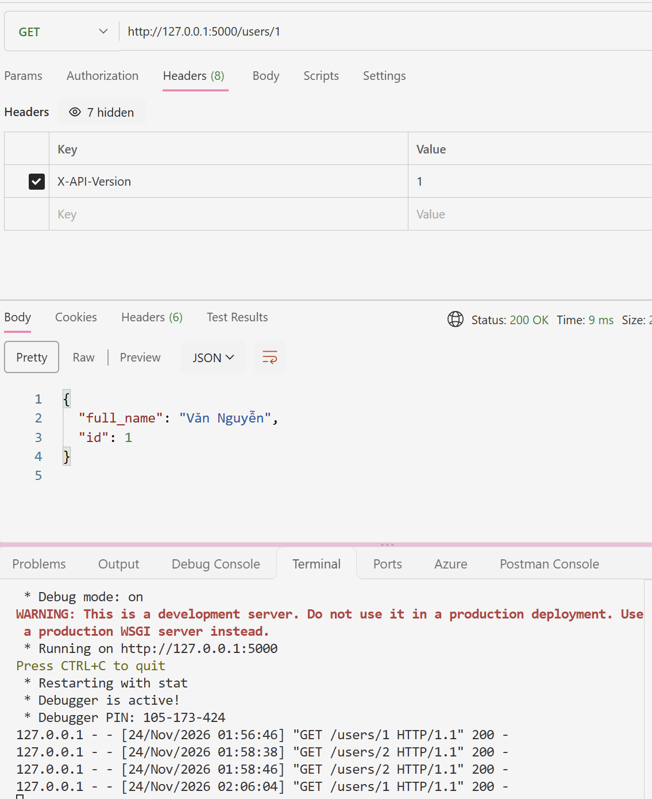
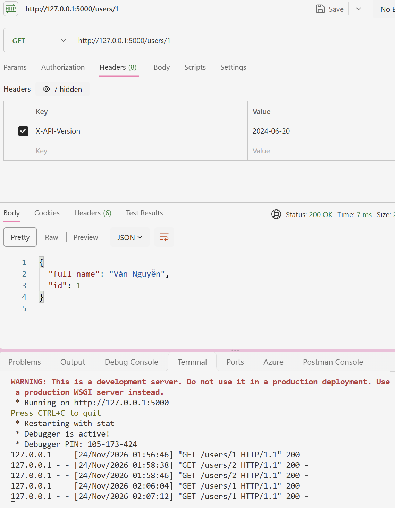
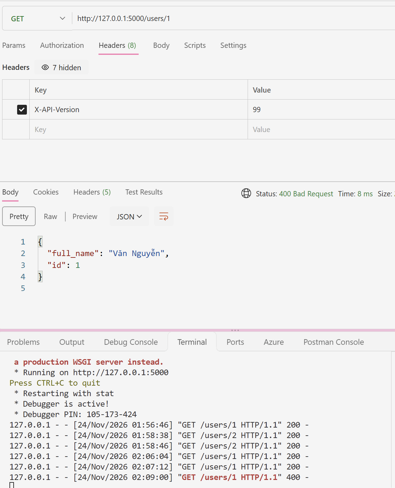

# BTVN buổi 9
## Lab 1: URI Path Versioning

## Lab 2: Header versioning với decorator @api_version
test endpoint mặc đinh

test với 'X-API-Version: 1'

test với 'X-API-Version: 2024-06-20'

test unsupported version
