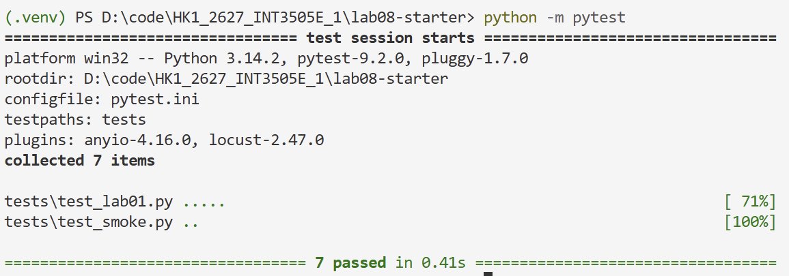
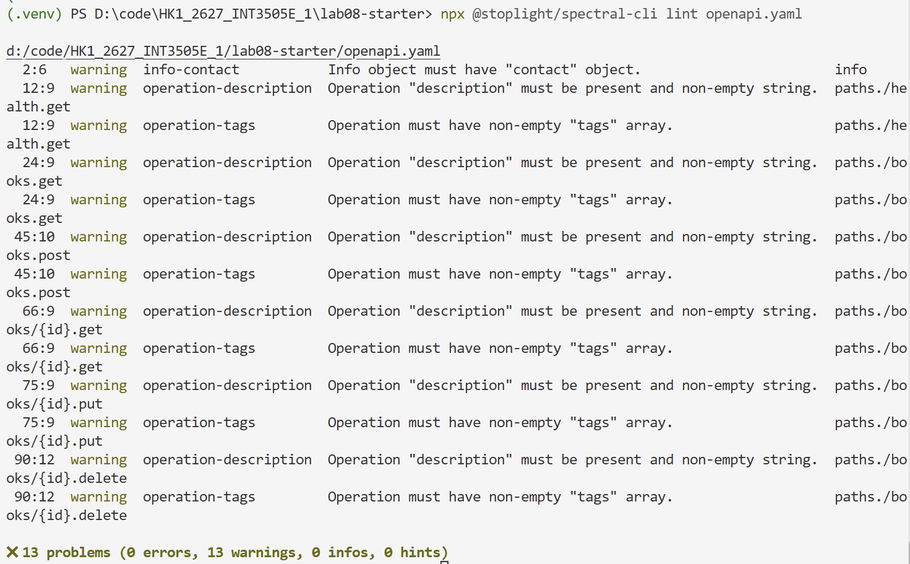
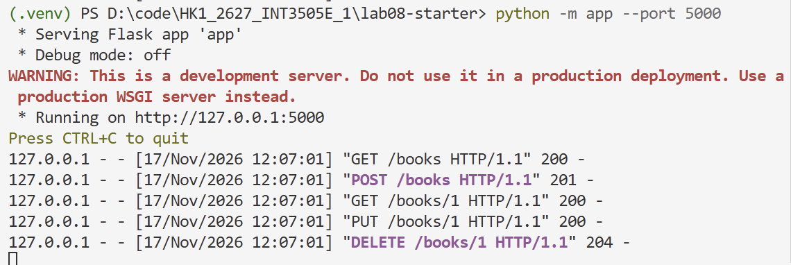
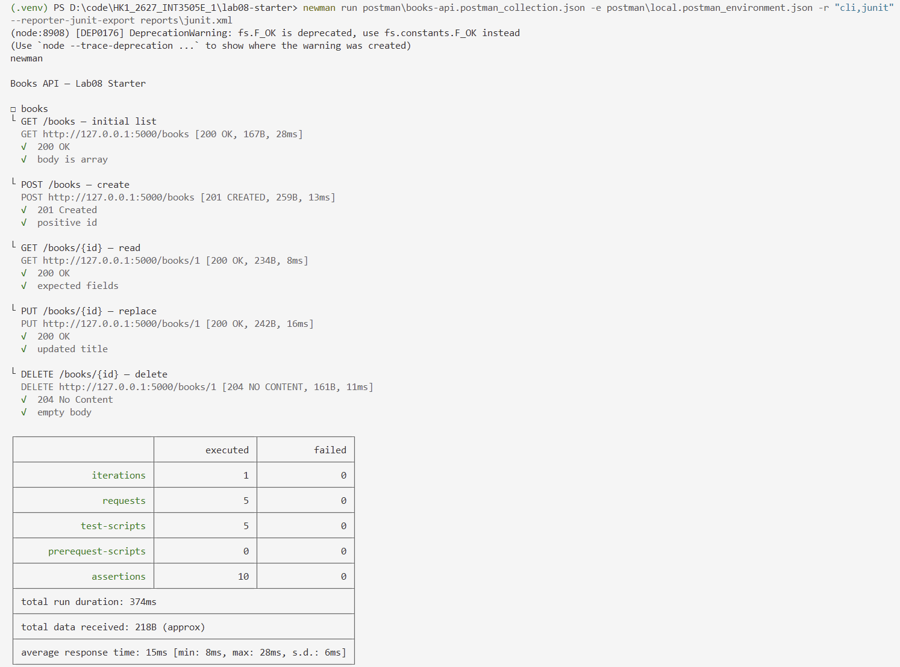
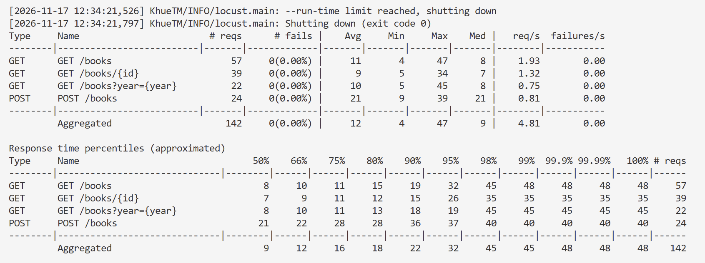
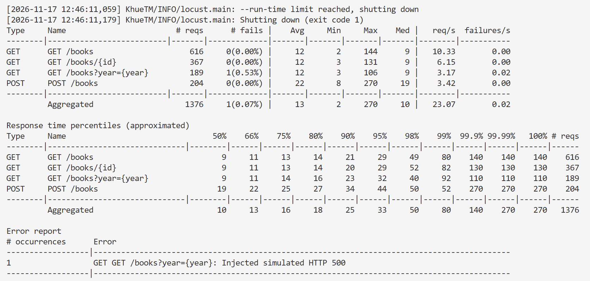
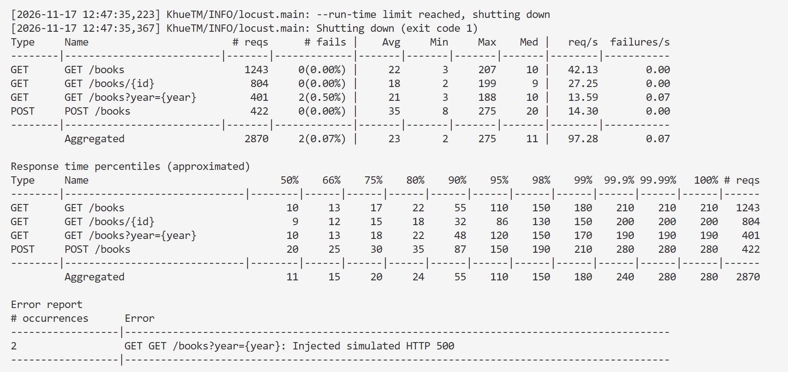

# lab08-starter — API Testing & Quality Assurance

**Flask 3.x / SQLAlchemy / pytest / OpenAPI / Postman / Locust**

## 1. Lab 1 — pytest

## 2. Lab 2 - OpenAPI/Spectral

## 3. Lab 3 - Postman/Newman
chạy lệnh python -m app --port 5000

chạy collection

## 4. Lab 4 - Locust
Kịch bản A: kết quả chạy

Kịch bản B: kết quả chạy

Kịch bản C: kết quả chạy
